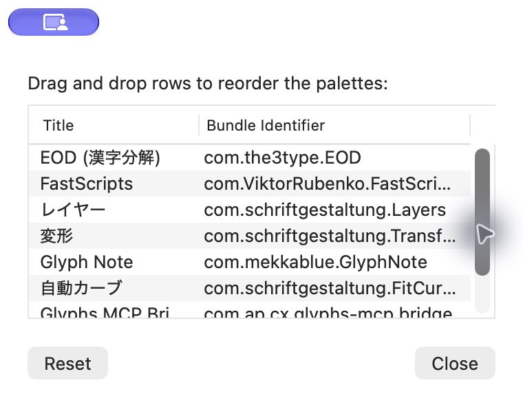

# ReorderPalettes for Glyphs 4

Glyphs 4 の右サイドバーにあるパレットの表示順を変更するプラグインです。Morisawa Inc. が公開した ReorderPalettes を基に、Tanukifont が Glyphs 4 対応を加えた非公式 fork です。[元のリポジトリ](https://github.com/morisawa-inc/ReorderPalettes)



## インストール

1. [Releases](https://github.com/tanukifont/ReorderPalettes/releases) から `ReorderPalettes-0.1.4.zip` をダウンロードして展開します。
2. `ReorderPalettes.glyphsPlugin` をダブルクリックし、Glyphs 4 のインストール確認を進めます。既存の ReorderPalettes がある場合は置き換えます。
3. Glyphs 4 を再起動します。

## 使い方

1. フォントウィンドウを開きます。
2. **Glyphs → Reorder Palettes…** を選びます。
3. 行をドラッグしてパレットの順序を変更します。
4. **Close** を押すと、開いているフォントウィンドウへ並び順が反映されます。

**Reset** を押してから **Close** を押すと、Glyphs の初期順に戻ります。並び順は新しく開くウィンドウと再起動後にも引き継がれます。

## Glyphs 4 対応での変更

- Glyphs 4 のサイドバーで読み込み済みのパレットを使用
- 既存のウィンドウへの並べ替え反映
- 通常の設定ウィンドウとしての表示
- ドラッグ後の一覧表示と内部データの同期
- Python 製パレットと複数クラスを含むプラグインの識別子表示

## 動作環境と確認範囲

- Glyphs 4
- macOS 12 以降
- Apple Silicon と Intel 向けの Universal バイナリ

実機で確認した環境は Glyphs 4.2（4202）、macOS 27.2.1、Apple Silicon です。その他の Glyphs ビルド、Intel Mac での実行、複数行の同時ドラッグは未確認です。詳しい確認内容は [TESTING.md](TESTING.md) を参照してください。

## ソースからビルド

macOS の Xcode Command Line Tools を使用します。

```sh
make
make archive
```

プラグインはリポジトリ直下、配布 ZIP は `build/` に生成されます。Xcode では `ReorderPalettes4` ターゲットを使用します。

## English

This unofficial fork adapts Morisawa Inc.'s ReorderPalettes to Glyphs 4. Drag rows in **Glyphs → Reorder Palettes…** and click **Close** to update the open font windows. **Reset** followed by **Close** restores the default order. The saved order is also used in new windows and after restarting Glyphs.

Download the ZIP from [Releases](https://github.com/tanukifont/ReorderPalettes/releases), install the `.glyphsPlugin`, and restart Glyphs 4. Native verification covers Glyphs 4.2 (4202) on Apple Silicon. The package includes arm64 and x86_64 code. See [TESTING.md](TESTING.md) for coverage.

## License

Apache License 2.0. Original copyright and attribution belong to Morisawa Inc. Glyphs 4 compatibility modifications are maintained by Tanukifont. See [LICENSE](LICENSE) and [NOTICE](NOTICE).
